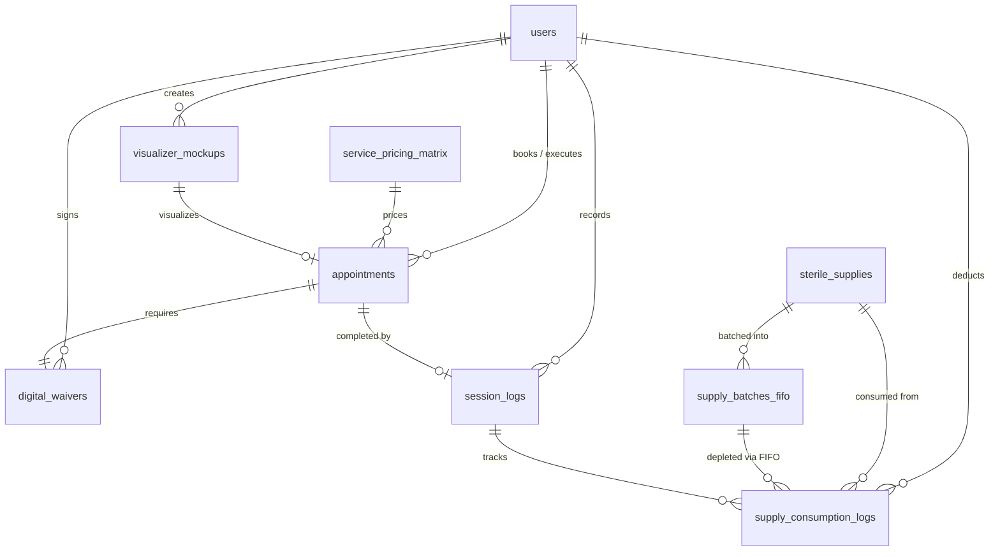

# Data Model & Relational Architecture: Aengelos Tattoo Studio

**Feature**: `001-tattoo-studio`  
**Database**: `aengelos_studio`  
**Engine**: MySQL 8.0 (InnoDB, `utf8mb4_unicode_ci`)  

---

## 1. Entity-Relationship Overview



---

## 2. Table Specifications & DDL Schemas

### 2.1 Table: `users`
Central user registry managing Client, Artist, and Administrator personas under strict RBAC.

| Column | Type | Constraints | Description |
| :--- | :--- | :--- | :--- |
| `id` | INT | PK, AUTO_INCREMENT | Unique user identifier |
| `role` | ENUM('client', 'artist', 'admin') | NOT NULL, DEFAULT 'client' | RBAC role |
| `full_name` | VARCHAR(120) | NOT NULL | User's full name |
| `email` | VARCHAR(120) | NOT NULL, UNIQUE | Authentication login & contact email |
| `phone` | VARCHAR(30) | NOT NULL | Mobile contact number |
| `password_hash` | VARCHAR(255) | NOT NULL | BCrypt hashed password |
| `created_at` | TIMESTAMP | DEFAULT CURRENT_TIMESTAMP | Account creation time |

---

### 2.2 Table: `service_pricing_matrix`
Standardized pricing matrix across Custom Design, Flash Art, and Cover-Up service categories.

| Column | Type | Constraints | Description |
| :--- | :--- | :--- | :--- |
| `id` | INT | PK, AUTO_INCREMENT | Service tier ID |
| `service_name` | VARCHAR(80) | NOT NULL | Service title (e.g. 'Custom Anatomical Piece') |
| `service_category` | ENUM('Custom Design', 'Flash Art', 'Cover-Up') | NOT NULL | Offering category |
| `base_price` | DECIMAL(10,2) | NOT NULL | Base studio rate in PHP |
| `deposit_required` | DECIMAL(10,2) | NOT NULL | Mandatory reservation down payment |
| `est_duration_mins` | INT | NOT NULL | Estimated studio chair duration in minutes |

---

### 2.3 Table: `visualizer_mockups`
2D canvas placement composite records generated from Fabric.js.

| Column | Type | Constraints | Description |
| :--- | :--- | :--- | :--- |
| `id` | INT | PK, AUTO_INCREMENT | Mockup composite ID |
| `client_id` | INT | NOT NULL, FK -> `users(id)` | Owning client |
| `body_region` | ENUM('forearm', 'calf', 'shoulder', 'back', 'chest') | NOT NULL | Selected anatomical body template |
| `raw_artwork_path` | VARCHAR(255) | NOT NULL | Path in `uploads/artworks/` |
| `mockup_image_path` | VARCHAR(255) | NOT NULL | Flattened composite in `uploads/mockups/` |
| `canvas_coords_json` | LONGTEXT | NOT NULL | Serialized Fabric.js transform state |
| `created_at` | TIMESTAMP | DEFAULT CURRENT_TIMESTAMP | Mockup generation time |

---

### 2.4 Table: `appointments`
Primary booking and scheduling entity with deposit verification workflows.

| Column | Type | Constraints | Description |
| :--- | :--- | :--- | :--- |
| `id` | INT | PK, AUTO_INCREMENT | Appointment ID |
| `client_id` | INT | NOT NULL, FK -> `users(id)` | Booking client |
| `artist_id` | INT | NOT NULL, FK -> `users(id)` | Assigned tattoo artist |
| `service_id` | INT | NOT NULL, FK -> `service_pricing_matrix(id)` | Service category |
| `mockup_id` | INT | NULL, FK -> `visualizer_mockups(id)` | Linked 2D placement mockup |
| `appointment_date` | DATE | NOT NULL | Scheduled calendar date |
| `appointment_time` | TIME | NOT NULL | Scheduled start time |
| `deposit_amount` | DECIMAL(10,2) | NOT NULL | Required reservation down payment |
| `payment_reference` | VARCHAR(100) | NOT NULL | Client transaction reference number |
| `receipt_image_path` | VARCHAR(255) | NOT NULL | Screenshot path in `uploads/receipts/` |
| `deposit_status` | ENUM('pending', 'verified', 'rejected') | DEFAULT 'pending' | Staff verification state |
| `booking_status` | ENUM('pending', 'confirmed', 'rescheduled', 'completed', 'cancelled') | DEFAULT 'pending' | Appointment lifecycle state |
| `created_at` | TIMESTAMP | DEFAULT CURRENT_TIMESTAMP | Booking creation time |

---

### 2.5 Table: `digital_waivers`
Immutable legal and health disclosure consent documents.

| Column | Type | Constraints | Description |
| :--- | :--- | :--- | :--- |
| `id` | INT | PK, AUTO_INCREMENT | Waiver ID |
| `appointment_id` | INT | NOT NULL, UNIQUE, FK -> `appointments(id)` | Linked appointment |
| `client_id` | INT | NOT NULL, FK -> `users(id)` | Signing client |
| `skin_allergies` | VARCHAR(255) | DEFAULT 'None' | Reported skin sensitivities |
| `keloid_history` | TINYINT(1) | DEFAULT 0 | Keloid / hypertrophic scarring history (1/0) |
| `medical_conditions`| VARCHAR(255) | DEFAULT 'None' | Bleeding disorders, cardiac, hepatitis, etc. |
| `signature_image_path`| VARCHAR(255)| NOT NULL | Transparent touch signature PNG |
| `pdf_archive_path` | VARCHAR(255) | NOT NULL | Immutable PDF archive path in `uploads/waivers_pdf/` |
| `sha256_hash` | CHAR(64) | NULL | Cryptographic checksum for tamper-evidence |
| `signed_at` | TIMESTAMP | DEFAULT CURRENT_TIMESTAMP | Digital signature timestamp |

---

### 2.6 Table: `session_logs`
Post-session procedure duration, billing, and notes logged by artists.

| Column | Type | Constraints | Description |
| :--- | :--- | :--- | :--- |
| `id` | INT | PK, AUTO_INCREMENT | Session log ID |
| `appointment_id` | INT | NOT NULL, UNIQUE, FK -> `appointments(id)` | Linked appointment |
| `artist_id` | INT | NOT NULL, FK -> `users(id)` | Executing tattoo artist |
| `duration_minutes` | INT | NOT NULL | Actual elapsed chair duration in minutes |
| `total_fee` | DECIMAL(10,2) | NOT NULL | Final billed procedure fee |
| `session_notes` | TEXT | NULL | Skin response, technical notes, aftercare advice |
| `logged_at` | TIMESTAMP | DEFAULT CURRENT_TIMESTAMP | Session completion timestamp |

---

### 2.7 Table: `sterile_supplies`
Master catalog of sterile needle cartridges, certified pigments, and protective barriers.

| Column | Type | Constraints | Description |
| :--- | :--- | :--- | :--- |
| `id` | INT | PK, AUTO_INCREMENT | Supply item SKU ID |
| `supply_name` | VARCHAR(120) | NOT NULL | Full supply item name and specifications |
| `category` | ENUM('Needle Cartridge', 'Certified Pigment', 'Protective Barrier') | NOT NULL | Supply regulatory category |
| `unit` | VARCHAR(30) | NOT NULL, DEFAULT 'pcs' | Stock unit (pcs, bottles, rolls) |
| `reorder_threshold` | INT | NOT NULL, DEFAULT 15 | Minimum stock before triggering dashboard alert |
| `total_stock` | INT | NOT NULL, DEFAULT 0 | Aggregate units remaining across active batches |

---

### 2.8 Table: `supply_batches_fifo`
Manufacturer lot registry enforcing First-In, First-Out (FIFO) stock allocation.

| Column | Type | Constraints | Description |
| :--- | :--- | :--- | :--- |
| `id` | INT | PK, AUTO_INCREMENT | Batch ID |
| `supply_id` | INT | NOT NULL, FK -> `sterile_supplies(id)` | Parent supply item |
| `batch_number` | VARCHAR(80) | NOT NULL | Supplier shipment batch code |
| `lot_number` | VARCHAR(80) | NOT NULL | Manufacturer sterile lot code |
| `qty_received` | INT | NOT NULL | Original quantity delivered |
| `qty_remaining` | INT | NOT NULL | Current active sterile quantity |
| `received_date` | DATE | NOT NULL | Intake delivery date |
| `expiration_date` | DATE | NOT NULL | Sterilization / shelf-life expiry date |
| `batch_status` | ENUM('active', 'depleted', 'expired') | DEFAULT 'active' | Operational batch status |

*Indexes*:
- `idx_fifo_lookup`: (`supply_id`, `batch_status`, `expiration_date`, `received_date`)

---

### 2.9 Table: `supply_consumption_logs`
Detailed audit trail of items deducted from specific FIFO batches during tattoo sessions.

| Column | Type | Constraints | Description |
| :--- | :--- | :--- | :--- |
| `id` | INT | PK, AUTO_INCREMENT | Consumption log ID |
| `session_id` | INT | NOT NULL, FK -> `session_logs(id)` | Associated session log |
| `supply_id` | INT | NOT NULL, FK -> `sterile_supplies(id)` | Consumed supply item |
| `batch_id` | INT | NOT NULL, FK -> `supply_batches_fifo(id)`| Depleted manufacturer batch |
| `qty_used` | INT | NOT NULL | Units consumed from this batch |
| `deducted_by` | INT | NOT NULL, FK -> `users(id)` | Artist / staff logging consumption |
| `deducted_at` | TIMESTAMP | DEFAULT CURRENT_TIMESTAMP | Deduction timestamp |

---

## 3. FIFO Consumption Engine Logic

```sql
-- 1. Query candidate active batches for item, ordered by earliest expiration
SELECT id, qty_remaining 
FROM supply_batches_fifo 
WHERE supply_id = :supply_id 
  AND batch_status = 'active' 
  AND expiration_date >= CURDATE() 
  AND qty_remaining > 0 
ORDER BY expiration_date ASC, received_date ASC, id ASC 
FOR UPDATE;

-- 2. Within PHP transaction:
--    - Allocate min(needed, batch.qty_remaining)
--    - Decrement batch.qty_remaining
--    - If batch.qty_remaining == 0: UPDATE batch_status = 'depleted'
--    - INSERT INTO supply_consumption_logs ...
--    - Recalculate and update sterile_supplies.total_stock
```
